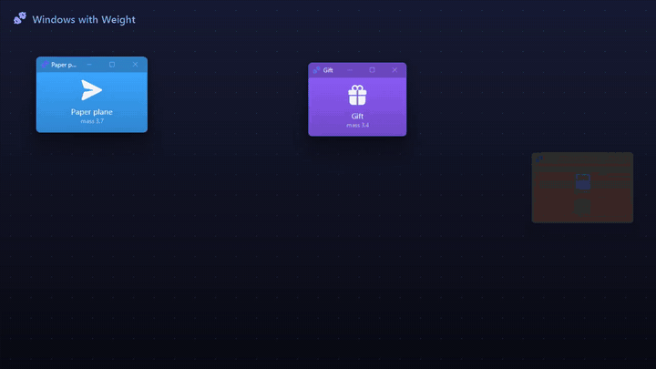

# Windows with Weight

A small Windows 11 tray app that gives the real top-level windows of every app physics.
Drag a window and let go while it is still moving: it keeps sliding with momentum, bounces off
the edges of the screen, bumps into other windows (mass = window area) and slowly stops.
Press **Ctrl+Alt+G** and every window on the monitor falls and piles up at the bottom. Press it
again and they all fly back.



`demo.mp4` / `demo.gif` were recorded from `--demo` (the app's own windows on a stage, see below).

## Download

Grab `WindowsWithWeight-win-x64.zip` from the [latest release](../../releases/latest), unzip it anywhere
and run `WindowsWithWeight.exe`. It is a single self-contained exe for Windows 10/11 x64 and needs no .NET
install. It is not code-signed, so SmartScreen may ask you to confirm the first time (More info → Run anyway).

## Build from source

Needs the .NET 10 SDK (`dotnet --list-sdks`). From this folder:

```powershell
dotnet run -c Release
# or build once and start the exe
dotnet build -c Release
.\bin\Release\net10.0-windows\WindowsWithWeight.exe
# or make the same single-file exe as the release
dotnet publish -c Release -r win-x64 --self-contained -p:PublishSingleFile=true -p:EnableCompressionInSingleFile=true -o publish
```

The app lives in the tray (dumbbell icon; it turns amber while gravity is on). It does not add
itself to startup and changes no system settings. Nothing is saved to disk.

| Command line | |
|---|---|
| *(none)* | tray app |
| `--disabled` | start with physics paused (tick **Enabled** in the tray to start) |
| `--preset light\|normal\|heavy` | start with a feel preset |
| `--exit` | close a running instance |
| `--selftest` | run the self-test (see below), exit code 0 = all passed |
| `--demo [--stage] [--record out.mp4] [--grabber ddagrab\|gdigrab]` | scripted show for videos |
| `--info` | read-only: monitors, DPI, and which windows are eligible and why others are skipped |

`WindowsWithWeight.exe` is a GUI exe, so pipe it when you want console output to wait for it, e.g.
`.\WindowsWithWeight.exe --selftest | Out-Host; $LASTEXITCODE`.

## Using it

* **Throw**: drag a window by its title bar and release while moving (above ~550 px/s on Normal).
  Slow, careful drags behave exactly as before.
* **Catch**: grab a sliding window and it stops instantly.
* **Collide**: a sliding window that hits another window pushes it. Small windows bounce off big
  ones; big ones shove small ones. Windows that already overlapped when you let go pass through each
  other until they separate (desktops are full of overlapping windows, and they should not explode).
* **Gravity** (Ctrl+Alt+G or tray): all eligible windows on the monitor under the mouse fall, bounce and
  stack. While gravity is on you can pick a window off the pile and toss it; anything you drop falls.
  Toggling again animates every window back to where it was when gravity started.
* **Restore positions** (Ctrl+Alt+R or tray): animates every window the app ever moved back to where it
  was before the app first touched it (for a throw: where the drag started).
* **Feel**: Light (floaty, bouncy), Normal, Heavy (short slides, dull bounces).
* **Enabled**: master switch. **Exit** puts gravity-mode windows back first.

## Hotkeys

| | |
|---|---|
| Ctrl+Alt+G | gravity on / off |
| Ctrl+Alt+R | restore positions |

If another app already owns a hotkey, a balloon tells you and the tray menu still works.

## How it works

* `SetWinEventHook` (out of context): `EVENT_SYSTEM_MOVESIZESTART/END` for every process, plus
  `EVENT_OBJECT_LOCATIONCHANGE` for the dragged window's process only while a drag is in progress.
  The simulation thread also samples the dragged window every frame, so a pause before release reads as
  a pause. Release velocity = displacement over the last 70 ms.
* The simulation runs on its own thread paced by `DwmFlush` (your display's refresh rate) with a fixed
  1/480 s physics step and interpolation. Windows are moved with
  `SetWindowPos(SWP_NOSIZE | SWP_NOZORDER | SWP_NOACTIVATE | SWP_ASYNCWINDOWPOS)`, so a frozen app
  cannot stall it. Nothing in the loop sends a window message.
* All geometry uses the visible frame (`DWMWA_EXTENDED_FRAME_BOUNDS`), not the window rect, so windows
  touch the edges and each other with no gap from the invisible resize borders.
* Walls are the union of all monitor work areas: a move that would put more of a window outside them
  is stopped at the exact contact point and reflected (restitution 0.5 on Normal). That one rule handles
  taskbars, monitors of different sizes and gaps between monitors.
* Collisions are impulse-based with mass = area, plus a little contact friction. Gravity mode adds
  gravity, floor friction and sleeping piles.
* Per-Monitor V2 DPI awareness (in `app.manifest`), so all coordinates are physical pixels on every
  monitor. Speeds and forces scale with each monitor's DPI.

## Safety

* Skipped: maximized, minimized, cloaked (other virtual desktops, suspended apps), tool windows,
  click-through/no-activate overlays, frameless popups, full-screen windows, the shell (taskbar,
  desktop, Start, flyouts), hung windows, and windows of processes with a higher integrity level
  (elevated apps, which UIPI would block anyway). `--info` lists the reason for each skipped window.
* A window can never be pushed past a work-area edge. If one starts with its title bar off-screen and
  then gets moved, it is pulled back until a grabbable strip of title bar is visible.
* The position before the app first moved a window is recorded, so Restore always has a target.
  Windows that were closed, minimized or maximized in the meantime are left alone.

## Self-test and demo

`--selftest` runs about 80 checks and prints `PASS`/`FAIL` for each, then `RESULT: PASS|FAIL`.
It uses a window source that only knows the test's own windows, so it cannot move anything else.
It never moves the mouse or synthesises input. Drags are driven by calling the same
MOVESIZESTART/END handlers the hook calls, while the real LOCATIONCHANGE hook and the simulation
thread sample the moving window. It covers:
* velocity estimation
* exact wall contact and restitution
* multi-monitor gaps
* momentum conservation, light-vs-heavy collisions, ghosting
* gravity stacking
* catch
* resize-is-not-a-throw
* frozen-app resilience (a test window whose thread is blocked)
* gravity on/off with exact restore
* the skip rules (minimized, maximized, tool, cloaked, shell, elevated)
* frame rate
* a final check that only test windows were ever moved

`--demo --stage` plays a 15 s choreography on a 16:9 backdrop: throw, light vs heavy, heavy shoves
light, gravity, toss onto the pile, restore. A drawn hand shows the scripted grabs.
`tools\record-demo.ps1` records it with ffmpeg (only the stage rectangle) and writes
`demo.mp4` and `demo.gif`. `tools\make-icons.ps1` rebuilds `Assets\*.png` and `Assets\app.ico` from the
Fluent UI System Icons SVGs in `Assets\fluent`.

## Known limits

* **Minimize-to-fall is not included.** An app outside the window's process can't intercept a
  minimize before it happens. That needs a global `WH_CBT`/`WH_CALLWNDPROC` hook, which means injecting
  32- and 64-bit native DLLs into every GUI process, and it still would not work for elevated, protected
  or UWP apps. `EVENT_SYSTEM_MINIMIZESTART` only arrives once the minimize animation is already playing.
  Faking the fall would mean restoring the window, animating it, minimizing it again and patching its
  restore placement. That gives a visible double animation, a focus flash, and confuses apps that hide
  to the tray on minimize. Turning off window animations is a system setting, so it is out too.
* Elevated (admin) windows are skipped unless you run Windows with Weight elevated too.
* Needs "Show window contents while dragging" (the Windows default). With outline dragging the window
  only moves on release, so there is no velocity to measure.
* Releasing with the cursor on a screen edge is left to Aero Snap (no throw).
* Windows are rigid boxes: no rotation. Apps that enforce their own position may fight a throw.
* When a window crosses into a monitor with different scaling, its app may resize it. The simulation
  follows the new size.
* Gravity only applies to the monitor under the mouse when you turn it on. Windows larger than that
  work area, maximized windows, and windows opened later do not take part.
* Restore records live in memory only and are forgotten when you exit. Feel and Enabled are not saved.
* The live global-hook path with a real mouse was not exercised by the automated test, which may not
  press the mouse. The self-test calls the same handlers instead.

## License

Copyright (c) 2026 FoOcean. Licensed under the GNU General Public License v3.0, see [LICENSE](LICENSE).

Icons are from [Fluent UI System Icons](https://github.com/microsoft/fluentui-system-icons) by Microsoft,
used under the MIT License ([Assets/fluent/LICENSE](Assets/fluent/LICENSE)).
